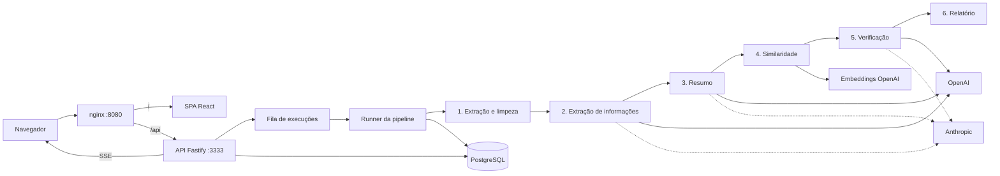

# DescomplicaAI

Simplificação e resumo de documentos jurídicos com IA generativa, sem perder as informações essenciais.

Você envia uma decisão judicial ou um ato normativo. O sistema extrai os dados importantes (datas, prazos, valores, obrigações, decisões, referências legais), escreve um resumo em linguagem simples e confere o resumo contra o documento original. Quando algo não bate, ele mostra um alerta com o trecho do documento e o trecho do resumo lado a lado.

Projeto acadêmico. O sistema ajuda a ler, mas não substitui o documento original nem orientação jurídica.

## Arquitetura



Monorepo com pnpm e Turborepo ([ADR 0001](docs/adr/0001-monorepo-turborepo-pnpm.md)): uma API Fastify e uma SPA React com Vite ([ADR 0002](docs/adr/0002-fastify-api-react-vite-spa.md)). A pipeline roda dentro do processo da API e grava um checkpoint por etapa ([ADR 0003](docs/adr/0003-in-process-pipeline-with-stage-checkpoints.md)). O progresso chega ao navegador por SSE, com replay do histórico ([ADR 0004](docs/adr/0004-realtime-sse-event-log-replay.md)). Tudo fica no PostgreSQL com Prisma, inclusive os logs e as chamadas de LLM ([ADR 0005](docs/adr/0005-postgresql-prisma-logs-in-database.md)).

## As 6 etapas

1. **Extração e limpeza.** Lê PDF, DOCX, HTML ou TXT e monta um texto canônico que nunca muda depois. A limpeza é determinística: cabeçalhos e rodapés repetidos, números de página, carimbos de assinatura, hifenização e parágrafos quebrados ([ADR 0010](docs/adr/0010-immutable-canonical-text-deterministic-cleaning.md)).
2. **Extração de informações.** Classifica o documento (decisão judicial ou ato normativo) e extrai fatos tipados. Cada fato precisa de uma citação literal, que é ancorada no texto canônico. Fatos sem âncora ou com valor que não bate com a citação ficam como incertos ([ADR 0011](docs/adr/0011-fact-schema-grounding-uncertainty.md)).
3. **Resumo.** Escreve o resumo em linguagem simples a partir do texto e dos fatos extraídos, com glossário e referência aos fatos usados em cada parágrafo ([ADR 0008](docs/adr/0008-typed-subagents-structured-output.md)).
4. **Similaridade.** Compara resumo e original com embeddings (centroide, cobertura, respaldo e alinhamento F1). Mede proximidade de assunto, não exatidão ([ADR 0006](docs/adr/0006-no-pgvector-in-memory-similarity.md), [ADR 0012](docs/adr/0012-similarity-metrics-not-fidelity.md)).
5. **Verificação.** Confere nos dois sentidos: cada fato crítico do documento aparece certo no resumo, e cada afirmação do resumo tem apoio no documento. Valores são comparados por código antes de pedir a opinião do modelo ([ADR 0013](docs/adr/0013-bidirectional-verification.md)).
6. **Relatório.** Junta as métricas, os alertas por prioridade e os custos da execução. Dá para baixar tudo em JSON ou CSV ([ADR 0015](docs/adr/0015-export-json-csv-zip.md)).

Modelos, estratégias e parâmetros de cada etapa vêm de um preset, salvo junto com cada execução ([ADR 0007](docs/adr/0007-ai-sdk-provider-registry.md), [ADR 0009](docs/adr/0009-pipeline-config-presets-snapshot.md)).

## Pré-requisitos

- Docker com Docker Compose.
- `OPENAI_API_KEY`, obrigatória. Os embeddings sempre usam OpenAI.
- `ANTHROPIC_API_KEY`, só para os presets `anthropic-default` e `cross-verifier`.

## Como rodar

```bash
cp .env.example .env
```

Coloque as chaves no `.env` e suba tudo:

```bash
docker compose up --build
```

Abra http://localhost:8080. A API também responde em http://localhost:3333. Na primeira subida a API aplica as migrations e carrega os 4 presets e os 20 documentos do corpus. As portas mudam com `WEB_PORT`, `API_PORT` e `POSTGRES_PORT` ([ADR 0016](docs/adr/0016-docker-compose-environment.md)).

## Desenvolvimento

Precisa de Node 24 e pnpm (via corepack).

```bash
pnpm i
docker compose up -d postgres
pnpm db:migrate
pnpm db:seed
pnpm dev
```

A web abre em http://localhost:5173 e a API em http://localhost:3333. Fora do Docker, ajuste no `.env` o host do banco para `localhost` e os caminhos `UPLOAD_DIR` e `CORPUS_DIR`.

## Testes

```bash
pnpm test
```

Os testes de integração da API usam o banco `app_test` do Postgres do compose (`TEST_DATABASE_URL`). Nenhum teste chama a API real dos providers: os modelos e os embeddings são simulados.

Para a verificação completa:

```bash
pnpm lint && pnpm typecheck && pnpm test && pnpm build
```

## Avaliação

Os dois scripts usam a API que estiver rodando e têm **custo real** de API. Eles pedem confirmação antes de começar (pule com `--yes`).

```bash
pnpm eval:corpus --preset openai-default
```

Processa os 20 documentos do corpus com um ou mais presets (`--preset` pode repetir). Use `--only <chave>` para um documento só e `--resume` para reaproveitar as execuções que já terminaram numa rodada interrompida. Uma rodada com `openai-default` custou perto de US$ 0,25 num ato curto do CNJ; documentos longos custam mais.

```bash
pnpm eval:faults --from-label eval-corpus
```

Injeta falhas determinísticas nos resumos já gerados (data trocada, valor trocado, prazo trocado, resultado invertido, omissão e frase inventada), reprocessa a partir da similaridade e mede quantas a verificação detecta. Use `--fault <tipo>` para rodar só alguns tipos ([ADR 0014](docs/adr/0014-evaluation-corpus-cross-matrix-fault-injection.md)).

Os relatórios ficam em `reports/<data>/` e `reports/<data>-faults/`, com `summary.md`, `results.csv` e `results.json`. O corpus está descrito em [`corpus/README.md`](corpus/README.md).

## Limitações

- Sem OCR: PDFs escaneados, sem camada de texto, são recusados.
- Tabelas de anexos viram texto corrido.
- O índice de legibilidade (Flesch adaptado ao português) conta sílabas de forma aproximada.
- Similaridade não é fidelidade: um resumo parecido com o original ainda pode trocar um prazo.
- Não há gabarito anotado por especialistas. As métricas comparam o resumo com os fatos que o próprio sistema extraiu.

## Estrutura do repositório

```
apps/
  api/          Fastify: rotas, fila de execuções, runner, SSE, exportação e CLIs de avaliação
  web/          React + Vite: envio, acompanhamento ao vivo, resultado, presets e comparação
packages/
  shared/       Schemas Zod do domínio, da configuração e da API
  pipeline/     As 6 etapas, os agentes de IA e a injeção de falhas
  db/           Prisma: schema, migrations e seed
  tsconfig/     Configurações base do TypeScript
corpus/         20 documentos públicos do STJ e do CNJ
docs/adr/       Decisões de arquitetura
```

## Decisões de arquitetura

Todas as decisões estão em [`docs/adr/`](docs/adr/).
